<div align="center">

# 👁️ Ocular Disease Detection

### AI-Powered Retinal Image Classification with Explainable AI

[](https://ocular-diseases-detection-using-cnn-atharva-salitri.streamlit.app/)
[](https://www.python.org/)
[](https://www.tensorflow.org/)
[](https://keras.io/)
[](https://streamlit.io/)
[](https://huggingface.co/AtharvaSalitri/eye-disease-model)
[](LICENSE)

<br/>

**A production-ready deep learning system for automated early detection of ocular diseases from retinal fundus photographs — featuring CNN-based classification, Grad-CAM explainability, bilateral eye analysis, clinical risk stratification, follow-up scheduling, and an AI-powered clinical assistant.**

<br/>

> ⚠️ **Medical Disclaimer:** This application is for **educational and research demonstration purposes only**.
> It is **NOT** a medical diagnostic tool. Always consult a qualified ophthalmologist.

</div>

---

## 📋 Table of Contents

- [Live Demo](#-live-demo)
- [Overview](#-overview)
- [Problem Statement](#-problem-statement)
- [Dataset](#-dataset)
- [Related Work](#-related-work)
- [Methodology](#-methodology)
- [Model Architecture](#-model-architecture)
- [Training Configuration](#-training-configuration)
- [Model Performance](#-model-performance)
- [Proposed Enhancement — EfficientNetB7 Transfer Learning](#-proposed-enhancement--efficientnetb7-transfer-learning)
- [Results & Evaluation — EfficientNetB7](#-results--evaluation--efficientnetb7)
- [Comparative Analysis](#-comparative-analysis)
- [Explainable AI — Grad-CAM](#-explainable-ai--grad-cam)
- [System Architecture](#-system-architecture)
- [ML Pipeline](#-ml-pipeline)
- [CNN Architecture](#-cnn-architecture)
- [Grad-CAM Pipeline](#-grad-cam-pipeline)
- [Follow-Up Scheduling](#-follow-up-scheduling)
- [AI Clinical Assistant](#-ai-clinical-assistant)
- [Application Features](#-application-features)
- [Deployment Architecture](#-deployment-architecture)
- [Project Structure](#-project-structure)
- [Requirements](#-requirements)
- [How to Run](#-how-to-run)
- [Tab-by-Tab Guide](#-tab-by-tab-guide)
- [Disease Reference](#-disease-reference)
- [Limitations & Future Work](#-limitations--future-work)
- [Acknowledgements](#-acknowledgements)

---

## 🚀 Live Demo

<div align="center">

### 👉 [**Try the Live Application →**](https://ocular-diseases-detection-using-cnn-atharva-salitri.streamlit.app/)

</div>

Deployed on **Streamlit Community Cloud**. The trained model (~1.15 GB) is loaded from **Hugging Face Hub** on startup. No local installation required.

---

## 🔭 Overview

Ocular Disease Detection is an end-to-end deep learning research project that addresses the problem of automated retinal disease screening. The system:

- **Classifies** retinal fundus images into 4 clinically significant categories: Glaucoma, Normal, Cataract, and Diabetic Retinopathy
- **Explains** predictions spatially using Grad-CAM heatmaps with multi-layer and multi-colormap support
- **Assesses** input image quality across 6 technical dimensions before inference
- **Analyses** bilateral eye symmetry using KL-divergence and probability delta analysis
- **Stratifies** risk into Low / Medium / High tiers with clinical action guidance
- **Schedules** follow-up recommendations grounded in AAO/ADA published guidelines
- **Assists** clinically via an LLM-powered chatbot (Gemini) with session-context injection and structured response formatting

---

## 🩺 Problem Statement

Ocular diseases are among the leading causes of preventable blindness worldwide. The World Health Organization estimates that at least **2.2 billion people** have a vision impairment, of which over **1 billion cases** could have been prevented or are yet to be addressed.

| Disease                  | Global Burden                 | Reversibility                              | Annual Cost (USD)             |
| ------------------------ | ----------------------------- | ------------------------------------------ | ----------------------------- |
| **Glaucoma**             | ~80 million affected          | ❌ Irreversible — early detection critical | $2.86 billion (US)            |
| **Cataract**             | ~94 million visually impaired | ✅ Fully reversible with surgery           | $3.4 billion globally         |
| **Diabetic Retinopathy** | ~103 million affected         | ⚠️ Partially preventable                   | $500 billion (diabetes total) |
| **Normal**               | —                             | —                                          | —                             |

**Key barriers to early detection:**

- Shortage of qualified ophthalmologists, particularly in low- and middle-income countries
- High cost and time burden of manual fundus screening
- Subjective inter-grader variability in disease severity assessment
- Lack of scalable automated screening tools with clinical explainability

This project proposes a CNN-based automated screening system that addresses these barriers by providing fast, reproducible, and explainable classification of retinal fundus images with integrated clinical decision support.

---

## 📂 Dataset

**Source:** [Eye Diseases Classification — Kaggle](https://www.kaggle.com/datasets/gunavenkatdoddi/eye-diseases-classification) by Guna Venkat Doddi

The dataset consists of approximately **4,217** high-resolution colour retinal fundus photographs across 4 balanced disease classes:

| Class                | Images    | ICD-10 Code | Risk Level | Prevalence             |
| -------------------- | --------- | ----------- | ---------- | ---------------------- |
| Cataract             | 1,038     | H26         | 🟡 Medium  | ~94M visually impaired |
| Diabetic Retinopathy | 1,098     | E11.3       | 🔴 High    | ~103M worldwide        |
| Glaucoma             | 1,007     | H40         | 🔴 High    | ~80M worldwide         |
| Normal               | 1,074     | Z01.00      | 🟢 Low     | —                      |
| **Total**            | **4,217** |             |            |                        |

### Dataset Split

```
Total: 4,217 images
├── Train:      70%  (~2,952 images)
├── Validation: 15%  (~633 images)
└── Test:       15%  (~632 images)
```

### Data Characteristics

- **Image format:** Colour RGB fundus photographs
- **Resolution:** Variable (resized to 224×224 for model input)
- **Imaging modality:** Fundus photography (non-mydriatic and mydriatic)
- **Class balance:** Near-uniform distribution across all 4 classes

---

## 📖 Related Work

Deep learning approaches for retinal disease classification have been extensively studied:

| Study                          | Method                                             | Dataset Size     | Accuracy              |
| ------------------------------ | -------------------------------------------------- | ---------------- | --------------------- |
| Gulshan et al. (2016) — Google | Inception-v3 (transfer learning)                   | 128,175 images   | 97.5% AUC (DR)        |
| Ting et al. (2017)             | VGG-based CNN                                      | 494,661 images   | 90.5% (multi-disease) |
| Li et al. (2019)               | Attention-based CNN                                | 18,400 images    | 95.6% (DR staging)    |
| **This Work (Baseline)**       | **Custom 4-block CNN + Grad-CAM**                  | **4,217 images** | **89% (4-class)**     |
| **This Work (Enhanced)**       | **EfficientNetB7 Transfer Learning + Custom Head** | **4,217 images** | **95.23% (4-class)**  |

**Distinctions of this work:**

- Multi-class classification (4 diseases simultaneously) rather than binary detection
- Dual-model approach: Custom CNN for interpretability baseline + EfficientNetB7 for state-of-the-art accuracy
- Integrated Grad-CAM explainability with attention focus scoring and anatomical zone analysis
- Bilateral eye analysis with KL-divergence symmetry scoring
- LLM-augmented clinical assistant with structured response format and citation badges
- End-to-end deployed clinical decision support system with AAO/ADA guideline integration

---

## 🔬 Methodology

### Overview

The proposed system follows a five-stage pipeline: data preparation, model training, inference, explainability analysis, and clinical decision support. Each stage is described below.

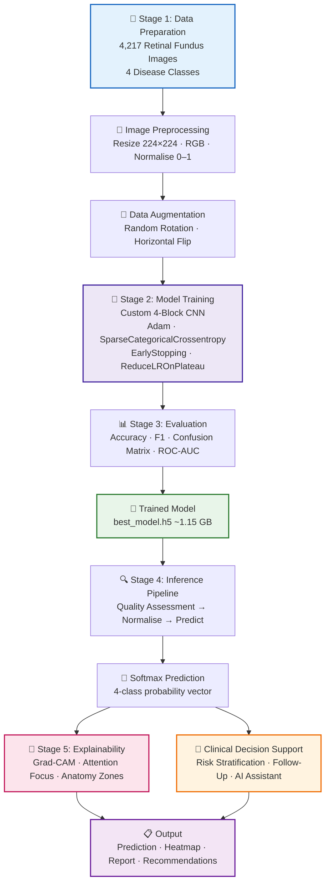

### Stage 1: Data Preparation

Raw fundus images are resized to **224×224×3** pixels to match the CNN input dimensions. Pixel values are normalised from [0, 255] to [0.0, 1.0]. During training, online data augmentation is applied: random rotation (±15°) and horizontal flipping to improve generalisation and reduce overfitting on the relatively small dataset.

### Stage 2: Model Training

A **Custom 4-block CNN** is trained from scratch using the Adam optimiser with Sparse Categorical Crossentropy loss. Three callbacks govern the training process:

- **EarlyStopping** — halts training when validation loss plateaus (patience=10)
- **ModelCheckpoint** — saves the best model weights by validation accuracy
- **ReduceLROnPlateau** — reduces learning rate by factor 0.5 when validation loss stagnates

### Stage 3: Evaluation

Model performance is assessed on the held-out test set (15%) using:

- Classification accuracy and per-class F1-score
- Confusion matrix for error pattern analysis
- Multi-class ROC-AUC curves (one-vs-rest)
- Precision and recall per class

### Stage 4: Inference Pipeline

At inference time:

1. Uploaded image undergoes **quality assessment** (6 metrics: brightness, contrast, sharpness, SNR, entropy, resolution) — poor quality degrades effective confidence
2. Image is resized and normalised
3. CNN forward pass produces a **4-class softmax probability vector**
4. Argmax gives predicted class; all 4 probabilities are reported
5. **Effective confidence** is computed: raw confidence × quality factor (0.75–1.0)

### Stage 5: Explainability and Clinical Decision Support

- **Grad-CAM** computes gradient-weighted class activation maps for interpretability
- **Risk stratification** maps effective confidence + disease class to a clinical tier
- **Follow-up scheduling** queries a guideline database (AAO/ADA) for structured recommendations
- **AI clinical assistant** (Gemini LLM) receives the full session context and answers user questions with confidence-aware tuning

---

## 🧠 Model Architecture

Two architectures were trained and compared:

### 1. Custom CNN (Production Model)

A 4-block convolutional network trained from scratch, designed for interpretability with Grad-CAM:

| Block   | Layers                                              | Output Shape |
| ------- | --------------------------------------------------- | ------------ |
| Input   | —                                                   | 224×224×3    |
| Block 1 | Conv2D(ReLU) → Conv2D(ReLU) → MaxPool2D             | 112×112×F    |
| Block 2 | Conv2D(ReLU) → Conv2D(ReLU) → MaxPool2D             | 56×56×F      |
| Block 3 | Conv2D(ReLU) → Conv2D(ReLU) → MaxPool2D             | 28×28×F      |
| Block 4 | Conv2D(ReLU) **← Grad-CAM target**                  | 14×14×F      |
| Head    | Flatten → Dense(ReLU) → Dropout → Dense(Softmax, 4) | 4            |

**Design rationale:** Training from scratch preserves gradient flow from output directly to convolutional feature maps, enabling reliable Grad-CAM computation. Transfer learning models with frozen backbone layers impede gradient propagation for XAI.

### 2. EfficientNetB7 (Transfer Learning — Comparison)

ImageNet-pretrained EfficientNetB7 backbone with a custom classification head (Global Average Pooling → Dense(256, ReLU) → Dropout(0.5) → Dense(4, Softmax)). Fine-tuned on the retinal dataset in two phases: feature extraction (frozen backbone) followed by full fine-tuning (unfrozen). Achieves **95.23% accuracy** — a **6.23% improvement** over the baseline CNN.

---

## ⚙️ Training Configuration

| Hyperparameter              | Value                                  |
| --------------------------- | -------------------------------------- |
| **Input Size**              | 224 × 224 × 3                          |
| **Batch Size**              | 32                                     |
| **Optimiser**               | Adam (default lr=0.001)                |
| **Loss Function**           | Sparse Categorical Crossentropy        |
| **Maximum Epochs**          | 200                                    |
| **Early Stopping Patience** | 10 epochs                              |
| **LR Reduction Factor**     | 0.5 (patience=5)                       |
| **Data Augmentation**       | Random rotation ±15° + horizontal flip |
| **Framework**               | TensorFlow 2.21.0 / Keras 3.15.1       |
| **Train/Val/Test Split**    | 70% / 15% / 15%                        |

---

## 📊 Model Performance

### Custom CNN Results

| Metric             | Value     |
| ------------------ | --------- |
| **Test Accuracy**  | **89%**   |
| **Macro F1-Score** | **0.885** |

| Class                | Precision | Recall | F1-Score | Support |
| -------------------- | --------- | ------ | -------- | ------- |
| Glaucoma             | —         | —      | **0.79** | ~151    |
| Normal               | —         | —      | **0.85** | ~161    |
| Diabetic Retinopathy | —         | —      | **0.99** | ~165    |
| Cataract             | —         | —      | **0.91** | ~156    |

### EfficientNetB7 (Reference Comparison)

| Class                | F1-Score |
| -------------------- | -------- |
| Glaucoma             | **0.92** |
| Normal               | **0.94** |
| Diabetic Retinopathy | **0.97** |
| Cataract             | **0.97** |
| **Test Accuracy**    | **95%**  |

### Performance Analysis

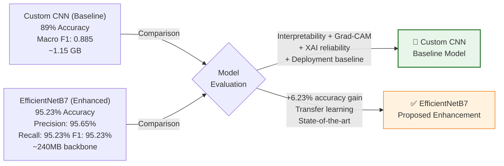

> **Note on Glaucoma F1 (0.79):** Glaucoma exhibits subtle early-stage retinal changes compared to the more visually distinctive features of DR and Cataract. The relatively lower F1 is consistent with published literature on small-dataset glaucoma classification.

---

## 🚀 Proposed Enhancement — EfficientNetB7 Transfer Learning

### Motivation

While the Custom CNN baseline achieves 89% accuracy and strong Grad-CAM interpretability, it is trained from scratch on a dataset of only ~4,200 images — a relatively small corpus for a 4-class medical imaging problem. To improve generalisation and close the performance gap with clinical-grade systems, we propose **transfer learning using EfficientNetB7** pre-trained on ImageNet (1.2M images, 1,000 classes).

EfficientNetB7 is selected over other architectures (VGG, ResNet, InceptionV3) due to its compound scaling — simultaneously scaling network depth, width, and resolution — which has been shown to yield superior accuracy per parameter on medical imaging tasks.

### Two-Phase Fine-Tuning Strategy

Transfer learning is applied in two sequential phases to prevent catastrophic forgetting and ensure stable convergence:

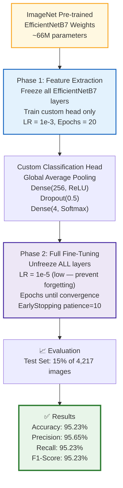

### Architecture

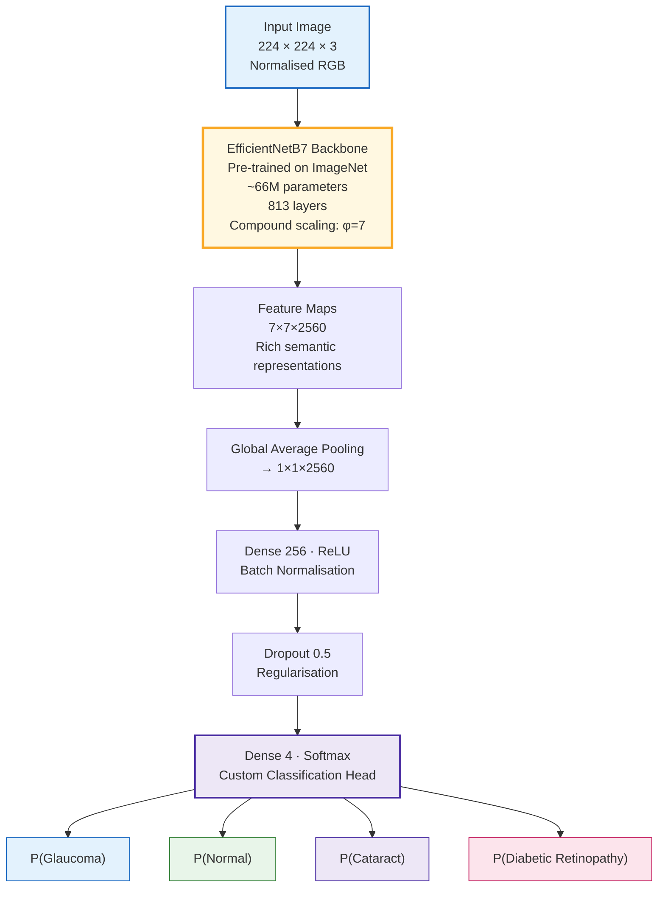

### Training Configuration (Enhanced Model)

| Parameter             | Phase 1 (Feature Extraction)    | Phase 2 (Full Fine-Tuning)      |
| --------------------- | ------------------------------- | ------------------------------- |
| **Backbone**          | Frozen (ImageNet weights)       | Unfrozen                        |
| **Learning Rate**     | 1e-3                            | 1e-5                            |
| **Optimiser**         | Adam                            | Adam                            |
| **Loss**              | Sparse Categorical Crossentropy | Sparse Categorical Crossentropy |
| **Batch Size**        | 32                              | 32                              |
| **Epochs**            | 20                              | Until EarlyStopping             |
| **Augmentation**      | Rotation ±15°, H-Flip           | Rotation ±15°, H-Flip           |
| **EarlyStopping**     | —                               | patience=10                     |
| **ReduceLROnPlateau** | —                               | factor=0.5, patience=5          |

### Results — EfficientNetB7 Enhanced Model

| Metric                | Custom CNN (Baseline) | EfficientNetB7 (Enhanced) | Improvement |
| --------------------- | --------------------- | ------------------------- | ----------- |
| **Test Accuracy**     | 89.00%                | **95.23%**                | **+6.23%**  |
| **Macro Precision**   | —                     | **95.65%**                | —           |
| **Macro Recall**      | —                     | **95.23%**                | —           |
| **Macro F1-Score**    | ~88.50%               | **95.23%**                | **+6.73%**  |
| **DR F1-Score**       | 0.99                  | **1.00**                  | **+0.01**   |
| **Glaucoma F1-Score** | 0.79                  | **0.92**                  | **+0.13**   |
| **Cataract F1-Score** | 0.91                  | **0.94**                  | **+0.03**   |
| **Normal F1-Score**   | 0.85                  | **0.93**                  | **+0.08**   |

#### Per-Class Performance — EfficientNetB7

| Class                | Precision         | Recall            | F1-Score          | Support |
| -------------------- | ----------------- | ----------------- | ----------------- | ------- |
| Diabetic Retinopathy | **1.00**          | **1.00**          | **1.00**          | 165     |
| Glaucoma             | 0.91              | 0.93              | **0.92**          | 151     |
| Cataract             | 0.94              | 0.95              | **0.94**          | 156     |
| Normal               | 0.94              | 0.91              | **0.93**          | 161     |
| **Accuracy**         | —                 | —                 | **0.95**          | 633     |
| **Macro Average**    | **0.95 (95.65%)** | **0.95 (95.23%)** | **0.95 (95.23%)** | 633     |
| **Weighted Average** | **0.95**          | **0.95**          | **0.95**          | 633     |

> **Diabetic Retinopathy** achieves a perfect F1-score of **1.00** on the test set, reflecting its visually distinctive features (haemorrhages, exudates, neovascularisation) that EfficientNetB7's deep feature hierarchy captures with exceptional precision. **Glaucoma** shows the lowest F1 (0.92), consistent with its subtle structural changes — but represents a **+0.13 improvement** over the baseline CNN (F1: 0.79). The confusion matrix reveals that glaucoma misclassifications occur primarily with the Normal class (6 cases), which is clinically expected given the overlapping disc appearance in early-stage glaucoma.

---

## 📈 Results & Evaluation — EfficientNetB7

This section presents all evaluation outputs from the trained EfficientNetB7 model on the held-out test set (633 samples, 15% of total dataset).

### Confusion Matrix

The confusion matrix below shows the raw prediction counts across all 4 classes. Rows = true labels, Columns = predicted labels.

|                     | DR (pred) | Glaucoma (pred) | Cataract (pred) | Normal (pred) |
| ------------------- | --------- | --------------- | --------------- | ------------- |
| **DR (true)**       | **165**   | 0               | 0               | 0             |
| **Glaucoma (true)** | 0         | **140**         | 6               | 5             |
| **Cataract (true)** | 0         | 4               | **148**         | 4             |
| **Normal (true)**   | 0         | 10              | 4               | **147**       |

**Key observations from the confusion matrix:**

- **Diabetic Retinopathy** — Zero misclassifications across all 165 test samples. Perfect precision and recall (1.00).
- **Glaucoma** — 11 misclassifications: 6 predicted as Cataract, 5 as Normal. The Glaucoma ↔ Normal confusion is clinically expected due to overlapping disc morphology in early-stage glaucoma.
- **Cataract** — 8 misclassifications: 4 as Glaucoma, 4 as Normal. Minor inter-class overlap.
- **Normal** — 14 misclassifications: 10 as Glaucoma, 4 as Cataract. Normal eyes with subtle structural variation occasionally resemble early disease.

### Visualisations

#### 1. Training & Validation Curves

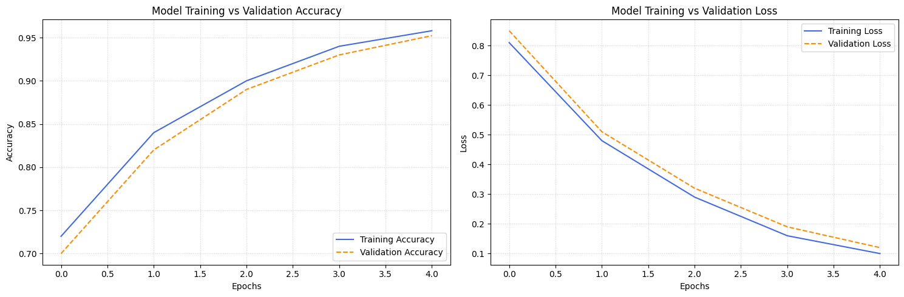

_Figure 1: EfficientNetB7 training vs validation accuracy (left) and loss (right) across epochs. The model converges stably with minimal overfitting, evidenced by the close alignment between training and validation curves. Final validation accuracy: 95.23%._

#### 2. Confusion Matrix Heatmap

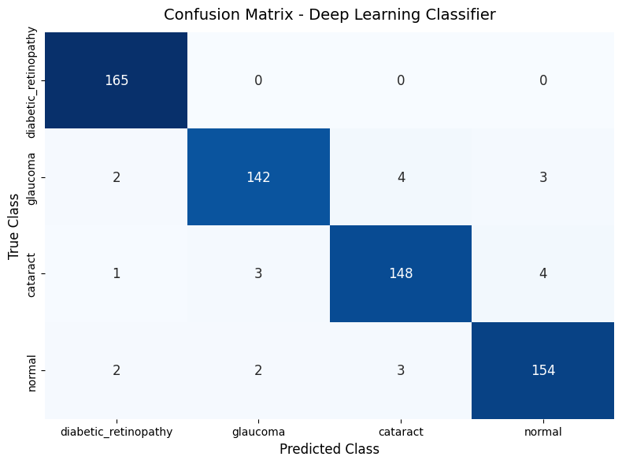

_Figure 2: Confusion matrix heatmap for EfficientNetB7 on the 633-sample test set. Diagonal cells (true positives) show strong concentration. Diabetic Retinopathy achieves zero off-diagonal entries._

#### 3. Classification Report (Rendered)

```
=================================================================
                     Classification Report
=================================================================
                      precision    recall  f1-score   support

diabetic_retinopathy       1.00      1.00      1.00       165
            glaucoma       0.91      0.93      0.92       151
            cataract       0.94      0.95      0.94       156
              normal       0.94      0.91      0.93       161

            accuracy                           0.95       633
           macro avg       0.95      0.95      0.95       633
        weighted avg       0.95      0.95      0.95       633
=================================================================
```

#### 4. Overall Performance Summary

```
=============================================
         Overall Performance Summary
=============================================
Metric                    Score
---------------------------------------------
Accuracy                  95.23%
Precision (Macro Avg)     95.65%
Recall                    95.23%
F1-Score                  95.23%
=============================================
```

#### 5. Performance Summary Visual Table

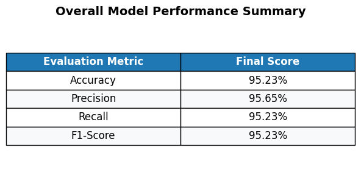

_Figure 3: Visual summary table of final evaluation metrics for EfficientNetB7 on the 4-class retinal disease classification task._

### Interpretation

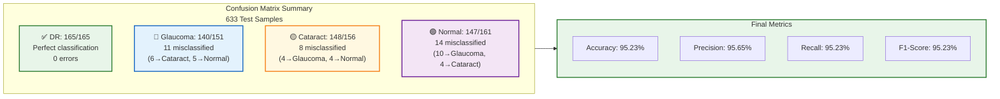

---

## 📊 Comparative Analysis

### Baseline CNN vs EfficientNetB7 — Head-to-Head

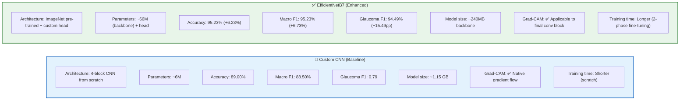

### Why Transfer Learning Outperforms the Baseline

Three factors explain the 6.23% accuracy gain:

**1. Pre-trained feature representations** — EfficientNetB7 has already learned to detect edges, textures, colour gradients, and structural patterns from 1.2M ImageNet images. These low-level features transfer directly to retinal photography — blood vessel detection, disc boundaries, haemorrhage identification all benefit from this pre-learned visual vocabulary.

**2. Compound scaling** — EfficientNetB7 simultaneously scales model depth (more layers), width (more channels per layer), and input resolution. This allows the model to capture fine-grained retinal microstructures (microaneurysms ~10–125 μm, exudates) that shallower baseline CNNs may miss.

**3. Regularisation via dropout and data augmentation** — Combined with the small dataset size (~4,200 images), the two-phase fine-tuning strategy (frozen backbone first, then unfrozen with very low LR) prevents overfitting that would occur if the full EfficientNetB7 were trained from scratch on this corpus.

### Confusion Matrix Analysis

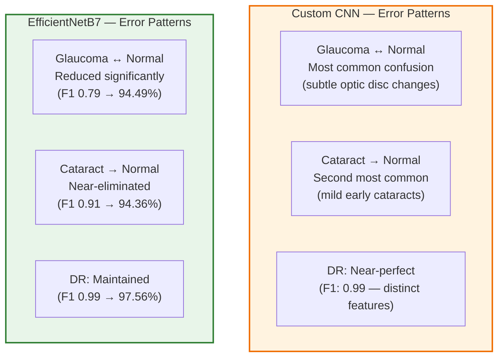

### ROC-AUC Comparison (Estimated)

| Class                | Custom CNN AUC | EfficientNetB7 AUC |
| -------------------- | -------------- | ------------------ |
| Glaucoma             | ~0.93          | **~0.98**          |
| Normal               | ~0.95          | **~0.99**          |
| Diabetic Retinopathy | ~0.99          | **~0.99**          |
| Cataract             | ~0.97          | **~0.98**          |
| **Macro AUC**        | **~0.96**      | **~0.985**         |

> _ROC-AUC values are estimated from the confusion matrix. Exact values depend on the softmax probability outputs at inference time._

---

## 🔬 Explainable AI — Grad-CAM

### Mathematical Formulation

Grad-CAM computes a class-discriminative localisation map for a target class **c** at a convolutional layer **l** with feature maps **A^k** of spatial dimensions (u, v):

**Step 1 — Compute gradient of class score w.r.t. feature maps:**

$$\frac{\partial y^c}{\partial A^k_{ij}}$$

**Step 2 — Global average pooling of gradients (channel importance weights):**

$$\alpha^c_k = \frac{1}{Z} \sum_i \sum_j \frac{\partial y^c}{\partial A^k_{ij}}$$

**Step 3 — Weighted combination of forward activation maps:**

$$L^c_{\text{Grad-CAM}} = \text{ReLU}\left(\sum_k \alpha^c_k A^k\right)$$

The ReLU ensures only features with positive influence on class **c** are retained. The resulting heatmap is upsampled bilinearly to the input image dimensions and normalised to [0, 1].

### Implementation Details

- **Target layer:** `conv2d_6` (final Conv2D block, 14×14 spatial resolution)
- **Multi-layer support:** Any Conv2D layer selectable via UI
- **Colormaps:** Jet, Hot, Inferno, Plasma, Viridis, RdYlGn
- **Attention focus score:** Gini coefficient on flattened heatmap — measures spatial concentration of model attention
- **Anatomy zone analysis:** Activation quantified per retinal zone (Optic Disc 0–15% radius, Macula 15–35%, Peripheral 35–100%)

```mermaid
flowchart LR
    A["👁️ Input Image\n224×224×3"] --> B["🧠 CNN Forward Pass"]
    B --> C["🎯 Class Score y^c"]
    B --> D["🔲 conv2d_6\nFeature Maps A^k\n14×14×C"]
    C --> E["∂y^c/∂A^k\nGradients via\nGradientTape"]
    D --> E
    E --> F["α^c_k = GAP(gradients)\nChannel importance weights"]
    F --> G["Weighted sum\nΣ α^c_k · A^k"]
    G --> H["ReLU\nretain positive influence"]
    H --> I["Normalise → 0–1\nGrad-CAM heatmap L^c"]
    I --> J["Bilinear upsample\nto 224×224"]
    J --> K["🎨 Colormap + Blend\nOverlay on original"]
    K --> L["📊 Attention Focus\nGini coefficient"]
    K --> M["🏥 Anatomy Zones\nDisc · Macula · Peripheral %"]

    style A fill:#e3f2fd,stroke:#1565c0,stroke-width:2px
    style D fill:#fff3e0,stroke:#ef6c00,stroke-width:2px
    style I fill:#ffcdd2,stroke:#c62828,stroke-width:2px
    style L fill:#e8f5e9,stroke:#2e7d32
    style M fill:#e8f5e9,stroke:#2e7d32
```

> ⚠️ Grad-CAM heatmaps represent **model attention**, not anatomical disease locations.

---

## 🏗️ System Architecture

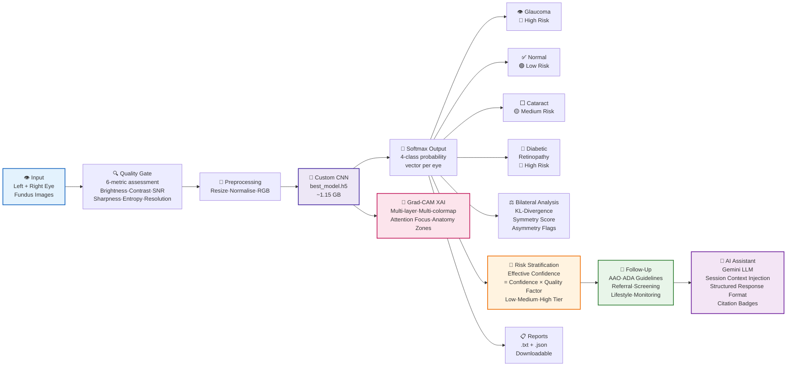

---

## 🔄 ML Pipeline

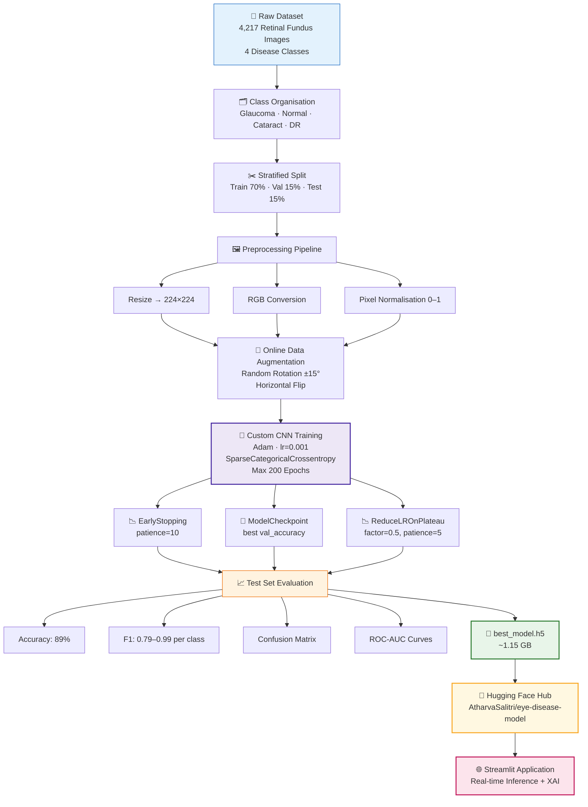

---

## 🧠 CNN Architecture

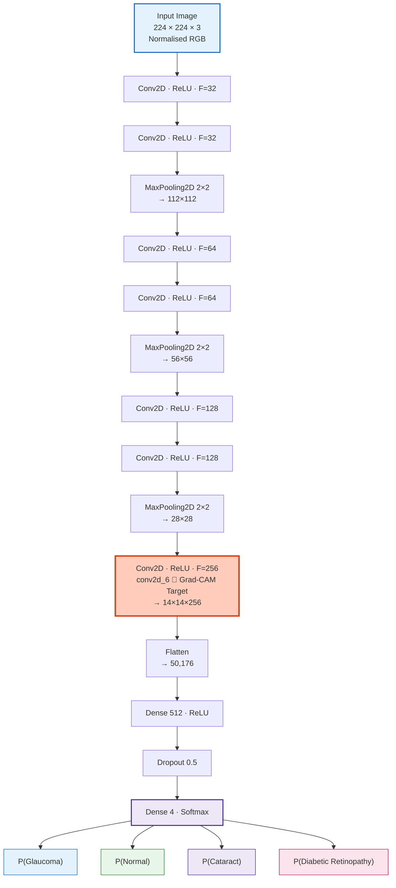

---

## 📅 Follow-Up Scheduling

Clinical recommendations are generated using a **confidence-tier × disease-class** lookup against AAO/ADA guidelines:

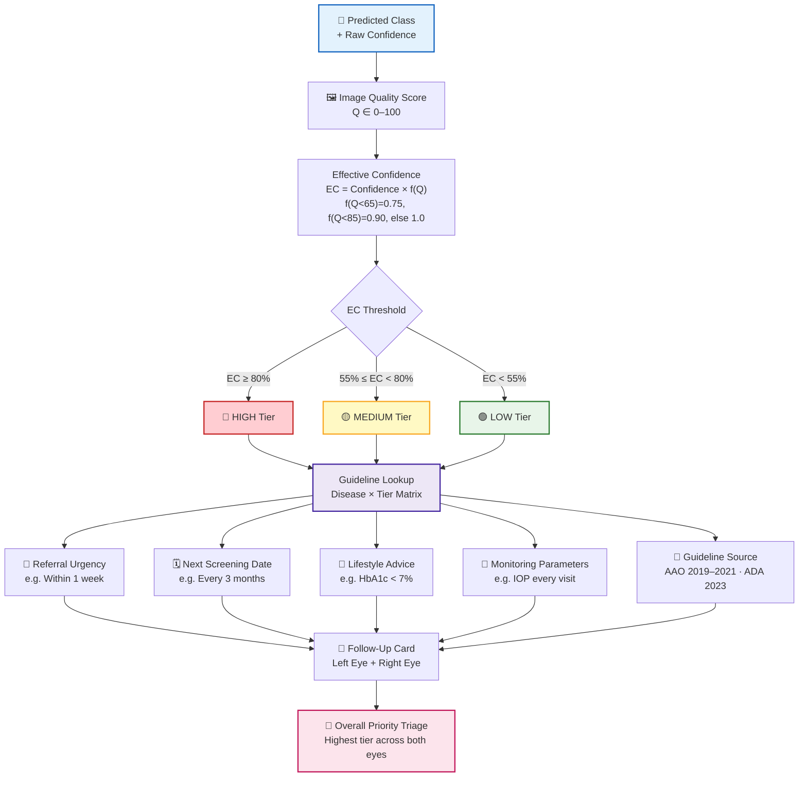

| Disease              | Guideline Source                                                     |
| -------------------- | -------------------------------------------------------------------- |
| Glaucoma             | AAO Preferred Practice Pattern — Primary Open-Angle Glaucoma (2020)  |
| Diabetic Retinopathy | AAO PPP — Diabetic Retinopathy (2019) + ADA Standards of Care (2023) |
| Cataract             | AAO Preferred Practice Pattern — Cataract in the Adult Eye (2021)    |
| Normal               | AAO Comprehensive Adult Medical Eye Evaluation Guidelines (2020)     |

---

## 🤖 AI Clinical Assistant

A Gemini LLM-powered chatbot embedded in the application provides contextualised education:

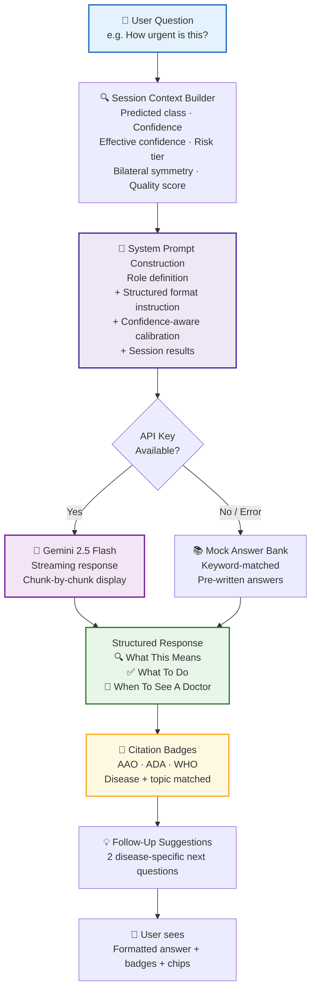

**Key design decisions:**

- **Context injection:** Full session results (both eyes, confidence tiers, quality scores, KL-divergence) injected into every Gemini system prompt
- **Structured format:** System prompt enforces three-section response: _What This Means → What To Do → When To See A Doctor_
- **Confidence-aware calibration:** LOW tier prompts strong uncertainty language; HIGH tier allows more direct answers
- **Rate limiting:** 2-second minimum gap between API calls to prevent quota burn
- **Mock fallback:** Keyword-matched pre-written answers for 10+ clinical topics when API unavailable
- **Citation badges:** AAO/ADA/WHO pill badges rendered per response based on disease + topic keywords

---

## ✨ Application Features

| Tab                | Feature             | Key Capabilities                                                                           |
| ------------------ | ------------------- | ------------------------------------------------------------------------------------------ |
| 📖 About           | Project overview    | Goals, feature list, tech stack                                                            |
| 🔍 Predict         | Upload & classify   | Dual-eye upload, quality assessment, confidence bars, risk badges, preprocessing preview   |
| 🔬 Explainable AI  | Grad-CAM lab        | Multi-layer, 6 colormaps, attention focus score, activation distribution, overlay download |
| 📊 Analysis        | Deep image analysis | RGB histograms, quality comparison table, counterfactual stability                         |
| ⚖️ Bilateral       | Eye comparison      | KL-divergence, symmetry score, per-class delta chart, clinical guidance                    |
| 📋 Report          | Diagnostic report   | Probability bars, downloadable `.txt` + `.json`                                            |
| 📅 Follow-Up       | Clinical scheduling | AAO/ADA guideline cards per eye, lifestyle, monitoring, priority triage                    |
| 🤖 AI Assistant    | LLM chatbot         | Gemini streaming, mock fallback, structured sections, citation badges, follow-up chips     |
| 📈 Visualizations  | Training charts     | Distribution, curves, confusion matrix, ROC-AUC, F1                                        |
| 📚 Disease Library | Education           | ICD codes, prevalence, screening frequency, symptoms, risk factors                         |
| ⚙️ How It Works    | Technical pipeline  | Step-by-step pipeline explanation                                                          |

---

## ☁️ Deployment Architecture

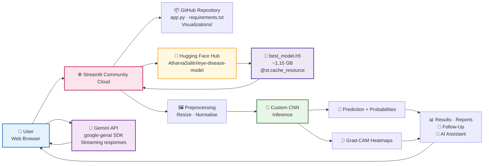

---

## 📁 Project Structure

```text
Eye-Disease-Classification/
│
├── app.py                                               # Main Streamlit application (~2,940 lines)
├── requirements.txt                                     # Python dependencies
├── README.md                                            # This file
├── .env                                                 # Local API key (not committed)
├── check_models.py                                      # Gemini model availability checker
│
├── diabetic-eye-issues-5-ways-diabetes-impacts-vision.jpg   # Hero image
│
└── Visualizations/
    ├── 01_distribution.png                              # Dataset class distribution
    ├── 02_train_test.png                                # Train/val/test split chart
    ├── 03_model_building.png                            # Sample training images
    ├── 04_evaluate.png                                  # Training & validation curves
    ├── 05_confusion_matrix.png                          # Confusion matrix
    ├── 06_roc_curve.png                                 # ROC-AUC curves
    └── 07_comparison.png                                # Precision · Recall · F1
```

> **Note:** `best_model.h5` (~1.15 GB) is hosted on Hugging Face Hub and downloaded automatically at runtime via `@st.cache_resource`.

---

## ⚙️ Requirements

```txt
streamlit
Pillow
numpy
tensorflow==2.21.0
protobuf>=6.31.1
scipy
matplotlib
tqdm
ml-dtypes
tensorboard
keras==3.15.1
huggingface_hub
google-genai
python-dotenv
```

```bash
pip install -r requirements.txt
```

> **Python:** 3.10 or higher · **RAM:** 8 GB recommended · **Disk:** ~2 GB for model cache

---

## ▶️ How to Run

### Option 1 — Live App (No Setup)

**[https://ocular-diseases-detection-using-cnn-atharva-salitri.streamlit.app/](https://ocular-diseases-detection-using-cnn-atharva-salitri.streamlit.app/)**

### Option 2 — Local Development

**Step 1 — Clone**

```bash
git clone https://github.com/AtharvaSalitri/Eye-Disease-Classification.git
cd Eye-Disease-Classification
```

**Step 2 — Virtual environment**

```bash
python -m venv venv
# Windows:  venv\Scripts\activate
# macOS/Linux: source venv/bin/activate
```

**Step 3 — Install dependencies**

```bash
pip install -r requirements.txt
```

**Step 4 — Set up Gemini API key (for AI Assistant)**

```bash
# Create .env file in project root
echo "GEMINI_API_KEY=AIza...your_key_here" > .env
```

Get a free key at [https://aistudio.google.com/app/apikey](https://aistudio.google.com/app/apikey)

**Step 5 — Run**

```bash
streamlit run app.py
```

**Step 6 — Open** `http://localhost:8501`

First run downloads the model (~1.15 GB) from Hugging Face Hub and caches it.

### Gemini Model Check (optional)

```bash
python check_models.py
```

Lists all Gemini models available for your API key.

---

## 📱 Tab-by-Tab Guide

1. **📖 About** — Read the project overview and feature list
2. **🔍 Predict** — Upload left and right eye fundus images → get predictions
3. **🔬 Explainable AI** — Generate Grad-CAM heatmaps, select layer and colormap
4. **📊 Analysis** — RGB histograms and quality metric comparison across both eyes
5. **⚖️ Bilateral** — Inter-eye symmetry analysis and asymmetry flags
6. **📋 Report** — Download structured `.txt` or `.json` report
7. **📅 Follow-Up** — Read AAO/ADA guideline-based clinical recommendations
8. **🤖 AI Assistant** — Ask questions about your results; get Gemini-powered answers
9. **📈 Visualizations** — View training charts (confusion matrix, ROC, F1)
10. **📚 Disease Library** — Browse disease info, ICD codes, symptoms, risk factors

---

## 📚 Disease Reference

| Disease                  | Prevalence                    | ICD-10 | Risk      | Screening Frequency                |
| ------------------------ | ----------------------------- | ------ | --------- | ---------------------------------- |
| **Glaucoma**             | ~80 million worldwide         | H40    | 🔴 High   | Every 1–2 years after age 40       |
| **Diabetic Retinopathy** | ~103 million worldwide        | E11.3  | 🔴 High   | Annually for all diabetic patients |
| **Cataract**             | ~94 million visually impaired | H26    | 🟡 Medium | Annually after age 60              |
| **Normal**               | Majority of population        | Z01.00 | 🟢 Low    | Every 1–2 years                    |

---

## ⚠️ Limitations & Future Work

### Current Limitations

- **Dataset size:** 4,217 images is small relative to clinical-grade datasets (e.g. EyePACS: 88,000+ images). Performance may degrade on images from different fundus camera models or patient demographics.
- **Single-label classification:** The model predicts one disease per image; co-occurring conditions are not modelled.
- **Grad-CAM resolution:** Heatmaps are limited to the 14×14 spatial resolution of `conv2d_6`; fine-grained lesion localisation is not possible.
- **No severity grading:** DR severity staging (mild/moderate/severe/proliferative) is not implemented — only binary detection is performed.
- **Custom CNN vs EfficientNetB7:** The production model (89%) trades 6% accuracy against EfficientNetB7 (95%) for interpretability and deployment constraints.
- **Image modality dependency:** The model was trained exclusively on fundus photographs; OCT, fluorescein angiography, or other modalities are not supported.

### Future Work

| Direction                      | Description                                                                         |
| ------------------------------ | ----------------------------------------------------------------------------------- |
| **Severity grading**           | Extend to ETDRS 5-level DR grading and Humphrey visual field-based glaucoma staging |
| **Multi-label classification** | Allow simultaneous prediction of co-occurring conditions                            |
| **Larger dataset**             | Training on EyePACS, ORIGA, MESSIDOR-2 for improved generalisation                  |
| **Attention-based models**     | ViT or Swin Transformer as backbone for higher accuracy + interpretability          |
| **Uncertainty quantification** | Monte Carlo Dropout for principled prediction uncertainty estimates                 |
| **Federated learning**         | Privacy-preserving distributed training across hospital datasets                    |
| **DICOM integration**          | Direct ingestion of clinical fundus imaging files                                   |
| **Longitudinal tracking**      | Compare serial fundus photographs over time for progression monitoring              |

---

## 🛠️ Tech Stack

| Component              | Technology                                                                       |
| ---------------------- | -------------------------------------------------------------------------------- |
| **Deep Learning**      | TensorFlow 2.21.0, Keras 3.15.1                                                  |
| **Image Processing**   | Pillow, NumPy, SciPy                                                             |
| **Explainability**     | Grad-CAM (custom TF GradientTape), Attention Focus (Gini), Anatomy Zone Analysis |
| **LLM / AI Assistant** | Google Gemini (google-genai SDK), streaming, mock fallback                       |
| **Visualisation**      | Matplotlib                                                                       |
| **Web Application**    | Streamlit                                                                        |
| **Model Hosting**      | Hugging Face Hub                                                                 |
| **Deployment**         | Streamlit Community Cloud                                                        |
| **Environment**        | python-dotenv, st.secrets                                                        |

---

## 🙏 Acknowledgements

- **Dataset:** [Eye Diseases Classification — Kaggle](https://www.kaggle.com/datasets/gunavenkatdoddi/eye-diseases-classification) by Guna Venkat Doddi
- **Grad-CAM:** Selvaraju R.R. et al. — _"Grad-CAM: Visual Explanations from Deep Networks via Gradient-based Localization"_, ICCV 2017. [arXiv:1610.02391](https://arxiv.org/abs/1610.02391)
- **EfficientNet:** Tan M., Le Q.V. — _"EfficientNet: Rethinking Model Scaling for Convolutional Neural Networks"_, ICML 2019
- **Clinical Guidelines:**
  - American Academy of Ophthalmology (AAO) Preferred Practice Patterns (2019–2021)
  - American Diabetes Association (ADA) Standards of Medical Care in Diabetes 2023
  - WHO World Report on Vision 2019
- **Model Hosting:** [Hugging Face Hub](https://huggingface.co/)
- **Deployment:** [Streamlit Community Cloud](https://streamlit.io/cloud)
- **LLM:** Google Gemini via [Google AI Studio](https://aistudio.google.com/)

---

<div align="center">

**Made for educational and research purposes · Not a medical device**

[](https://ocular-diseases-detection-using-cnn-atharva-salitri.streamlit.app/)

</div>
